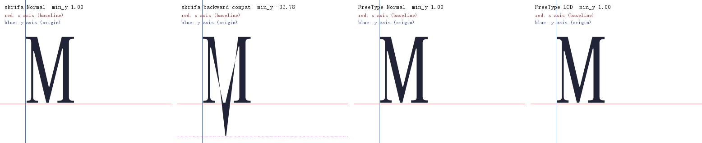

# fontations-hint-repro

Minimal reproduction for the fontations (skrifa) hinting issue seen in `ofdbox-folio`:
the hinted outline of SimSun's `M` ends up below the baseline when the backward-compatibility
hinting mode is forced.

The binary has two parts:

- **skrifa part (reproduction, only depends on fontations)**: draws one glyph through
  `skrifa::outline` with several hinting configurations and prints the lowest outline point.
- **FreeType part (reference)**: loads the same glyph through the vendored FreeType with
  `FT_LOAD_NO_HINTING`, `FT_LOAD_TARGET_NORMAL`, `FT_LOAD_TARGET_LCD`, `FT_LOAD_TARGET_LCD_V`
  and `FT_LOAD_TARGET_MONO`, and prints the lowest outline point for each.

It also writes `comparison.png`, which draws the glyph with both libraries and marks the text
axes.

## Run

```powershell
cargo run --release
# or explicitly:
cargo run --release -- "C:/Windows/Fonts/simsun.ttc" M 100 comparison.png
```

## Output image



Four panels, left to right:

1. skrifa, `Target::Smooth { mode: Normal }` (hinting with backward compatibility off)
2. skrifa, `Target::Smooth { mode: Lcd, preserve_linear_metrics: true }` (backward compatibility
   forced on)
3. FreeType, `FT_LOAD_TARGET_NORMAL`
4. FreeType, `FT_LOAD_TARGET_LCD`

Every panel draws the glyph outline plus the text axes:

- **red line**: x axis, i.e. the baseline (`y = 0` in glyph space)
- **blue line**: y axis, i.e. the glyph origin (`x = 0` in glyph space)
- **dashed magenta line**: the lowest outline point, drawn only when it falls below the baseline

The second panel shows the bug: two points of the `M` apex are moved 0.34 em below the
baseline, so the middle vertex pokes through the red baseline, while the other three panels keep
the glyph on the baseline.

## Console output (Windows 10/11, SimSun from `C:/Windows/Fonts/simsun.ttc`, 100 ppem)

```
--- skrifa (fontations) ---
unhinted                           min_y =     1.56  points below baseline: 0
hinted Normal target               min_y =     1.00  points below baseline: 0
hinted backward-compatibility      min_y =   -32.78  points below baseline: 2
hinted Mono target                 min_y =     1.00  points below baseline: 0

--- FreeType ---
no hinting                         min_y =     1.56  points below baseline: 0
target Normal                      min_y =     1.00  points below baseline: 0
target LCD                         min_y =     1.00  points below baseline: 0
target LCD_V                       min_y =     1.00  points below baseline: 0
target Mono                        min_y =     1.00  points below baseline: 0
```

## What this shows

- Only skrifa's backward-compatibility mode (triggered by
  `Target::Smooth { mode: Lcd, symmetric_rendering: false, preserve_linear_metrics: true }`,
  which internally sets `backward_compatibility = true`) moves two points of the `M` apex to
  `-0.34 em` below the baseline. The same font, size and glyph are correct unhinted, with the
  Normal target, with the Mono target, and in FreeType for every load target.
- `vello_cpu 0.3.0` delegates glyph rendering to `glifo 0.4.0`, which hard-codes exactly that
  target combination in `HINTING_OPTIONS`. That is why the CPU renderer in `ofdbox-folio`
  showed the spike.
- `ofdbox-folio` works around it by disabling hinting in its CPU text path (glyph runs use
  `.hint(false)`), which matches the outline produced by the GPU backend.

## Caveat

FreeType only enters backward-compatibility mode when the TrueType v40 interpreter runs with
"lean" subpixel hinting *and* the font's `prep` table does not opt out via `INSTCTRL` bit 2.
SimSun's `prep` sets that bit, so FreeType keeps backward-compatibility off for every load
target above; the comparison proves that FreeType's effective behaviour stays on the baseline.
skrifa's `preserve_linear_metrics: true` forces the mode regardless of the font's opt-out, which
is the divergence this reproduction isolates.

## Build notes

`vendor/freetype-sys` is a copy of the `freetype-sys 0.23.0` crate with its build script
replaced by a CMake build of the vendored FreeType (PNG/zlib/brotli/harfbuzz disabled), because
the published crate's `bundled` feature expects a zlib source tree that is not shipped. MSBuild's
temporary files are redirected into `OUT_DIR` because the default user temp directory is not
always writable for MSBuild in this environment.
